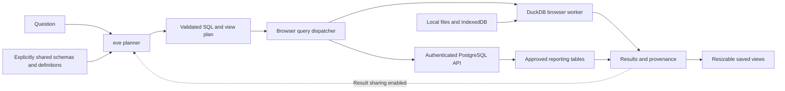

# Architecture

Last updated: 2026-10-20

Sift is a self-hostable Next.js application with Vercel eve for conversational planning, DuckDB WASM for browser-local analysis, and an authenticated PostgreSQL adapter for approved server-side reporting datasets.

## Ownership

| Surface | Owner |
| --- | --- |
| Workspace, datasets, views, metrics, result and connector shapes | [`lib/types.ts`](../lib/types.ts) |
| SELECT/WITH validation, dataset scope, function allowlist | [`lib/sql-policy.ts`](../lib/sql-policy.ts) |
| DuckDB worker, local imports, limits and cancellation | [`lib/engine.ts`](../lib/engine.ts) |
| Lossless JSON numbers, typed imports and Arrow value serialization | [`lib/data-values.ts`](../lib/data-values.ts) |
| IndexedDB upload bytes and localStorage metadata | [`lib/storage.ts`](../lib/storage.ts) |
| Deterministic demo dataset, metric definitions and initial view | [`lib/demo.ts`](../lib/demo.ts) |
| Server-configured PostgreSQL connection and execution | [`lib/postgres.ts`](../lib/postgres.ts) and [`app/api/postgres/route.ts`](../app/api/postgres/route.ts) |
| Workspace actions, data exposure settings and conversation UI | [`components/SiftApp.tsx`](../components/SiftApp.tsx) |
| Chart/table rendering and responsive panel layout | [`components/PanelCard.tsx`](../components/PanelCard.tsx) and [`components/DashboardGrid.tsx`](../components/DashboardGrid.tsx) |
| Portable connector acceptance helper | [`scripts/check-connector.ts`](../scripts/check-connector.ts) |

## Local execution and persistence

The first browser initialization creates a 432-row SaaS sample spanning January–December 2025 and restores uploaded files from IndexedDB. The initial view contains three metrics, a revenue trend, acquisition mix, and plan performance. Every panel has reproducible SQL and an explicit dataset scope. The sample is labeled and independent of current time or external providers.

Supported uploads are CSV, TSV, JSON, JSONL/NDJSON, XLSX, and Parquet, with a 20 MB per-file limit. XLSX imports select a sheet; JSON rows must be objects. Structured JSON values become strings. Imported tables receive generated safe identifiers. Trusted import SQL materializes registered local buffers into an in-memory DuckDB database. Analytical queries cannot invoke these file readers.

The browser engine serializes operations. Queries validate the registered dataset identities, parse and regenerate one read-only SQL statement, then execute an outer 1,001-row probe. The public result contains at most 1,000 rows and discloses truncation. A ten-second execution timer or AbortSignal terminates the worker. The next operation recreates the engine from the deterministic demo and persisted files. Uploaded bytes and query execution do not traverse the application server.

JSON number tokens and XLSX numeric cells avoid JavaScript Number conversion during import. Explicit column types preserve text IDs and exact decimals; values that exceed DuckDB's decimal capacity remain text. Arrow decimal scales and raw timestamp units survive result serialization. Charts decline values that would require unsafe numeric coercion; the inspector and exports retain the exact result. Currency labels require an explicit supported ISO code. CSV/TSV automatic type inference remains a separate precision boundary documented in the connector guide.

Worker startup and import operations have 30-second deadlines; saved-file restoration has a bounded total budget. Aborting an import or query terminates its worker. Main-thread file preparation has size and complexity limits; asynchronous deadlines cannot preempt synchronous JavaScript parsing. Failed saved files appear in the source dialog and can be removed without successfully restoring them.

IndexedDB stores file bytes, chosen sheets, stable dataset IDs, and import timestamps. localStorage stores dataset metadata, view definitions, layouts, metric definitions, sharing preferences, and conversation state. Workspace saving omits query result rows; panels rerun after reload. Conversation history can contain results explicitly shared with the model. Browser storage belongs to one browser profile and deployment origin. Clearing it removes the local workspace and files. Exported view/workspace JSON can contain results and should be handled as data.

AI tool plans add a stable view ID and an applied-call receipt in the same workspace update. Reloading cannot retain a receipt without its view: pending panels rerun, and durable tool replay does not duplicate the view. Concurrent plans retain separate cancellation controllers. Conversation reset waits for local work, clears queued explanations, and cannot receive an old session's results; remounting cancels the old component's local work.

## PostgreSQL execution

The administrator supplies connection URLs and schema-qualified table allowlists through server environment variables. Credentials are never accepted as a public request parameter. Discovery and query routes require the deployment Bearer token when configured. Dataset IDs are resolved against server configuration before execution; one query can use tables from one configured connection.

The adapter uses a dedicated client, a read-only transaction, a database statement timeout, and an outer result probe. Configure a least-privilege read-only database role as an additional source boundary. An aborted browser HTTP request does not establish that PostgreSQL cancelled its work; the SQL timeout bounds server execution. See [connectors](connectors.md) for setup and current verification limits.

Client-local PostgreSQL type parsers preserve exact numeric, JSON, array, and custom-type text. Calendar timestamps retain their fractional precision without passing through JavaScript Date's local-timezone conversion. Native booleans, small integers, and floating types retain their normal primitive representation; nonfinite floating values become explicit strings rather than null.

The server can reach only networks available to its deployment. Self-host the application near a private database when necessary. The first version has no customer-installed private worker, outbound gateway, federation engine, or cross-source extract service.

## Model and data boundaries

The model proposes SQL and view definitions through eve tools; the client executes queries through the appropriate connector. Model output never grants access. The SQL policy, registered dataset scope, server configuration, source identity, and runtime limits independently constrain execution.

Schema sharing and result sharing are separate. The generated sample starts with both enabled; uploading a file or connecting PostgreSQL disables both so a new source is not implicitly disclosed. Schema sharing includes dataset/table names, columns/types, and metric definitions. Result sharing permits up to 50 rows per query in an explanatory model request and can include raw values; the UI describes this explicitly. The model provider runs where the eve deployment is configured; keeping SQL local does not make an opted-in model explanation local.

The interface stores approved metric definitions alongside SQL. Revenue, customers, growth, currency, and aggregation grain must be explicit. The demo's customer values are monthly snapshots, so active customers use the latest month rather than summing customers across time. The initial revenue definition excludes refunds and taxes and uses USD.

## Evidence and extension boundaries

Results preserve the executed query, named column types, returned row count, source names/freshness, execution timestamp, duration, truncation, and approximation. Column types distinguish numeric strings from text identifiers such as `00123`, so presentation does not remove significant zeroes. A complete result is distinct from a chart displaying a subset of returned rows. Discovery time is distinct from a source's ingestion watermark. A PostgreSQL row count of `-1` means unknown.

[`AnalyticsConnector`](../lib/types.ts) is the extension contract. The browser connector implements it; the server PostgreSQL adapter currently exposes equivalent query behavior through its authenticated route. Capabilities describe supported modes and execution location. Semantic layers, SaaS record synchronization, warehouses, object storage, streams, and private workers are future adapters, each with its own permission, completeness, and acceptance requirements.

The conformance helper is delivered for explicit integration checks. Static checks establish local types and policy behavior; they do not prove live database access, model-provider operation, workbook/file runtime behavior, a hosted deployment, or a published release. Record those acceptance results separately when their environments and credentials are available.
